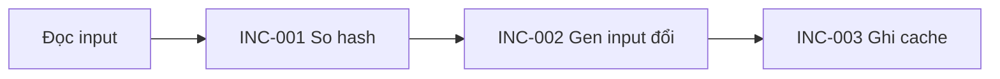

# Quy chuẩn viết spec

Spec là contract của project; mỗi file có một phạm vi độc lập. Code, test và runbook phải implement và verify các yêu cầu `Approved`. Khi code và spec mâu thuẫn, spec thắng.

Spec có ba lớp để người đọc đi từ overview đến implementation detail:

1. **Overview:** mục tiêu, phạm vi và workflow chính.
2. **Feature list:** các outcome/capability trong scope, mỗi dòng có tên dễ quét và ID tới các yêu cầu chi tiết.
3. **Chi tiết:** contract, design/implementation notes nếu cần, và cách kiểm chứng theo từng ID.

**Cách dùng:** copy `Mẫu` bên dưới vào `specs/<scope-slug>.md` → điền theo `Cách điền` → thay nội dung minh họa theo task → chạy `Tự kiểm`. Người đọc phải hiểu mục tiêu và workflow trong 1 phút từ phần đầu file; đặt `Feature list` ngay sau `Workflow` để tra cứu nhanh.

## Mẫu

Nội dung dưới đây chỉ minh họa một task có behavior. Dùng cùng khung cho task khác; thêm/bỏ detail theo loại task.

````md
# <Tên spec>
Status: Draft · Audited: Not yet

## Overview
<Mục tiêu của task trong một câu.>

## Workflow


## Feature list
| Feature / outcome | Tóm tắt | Requirement IDs |
|---|---|---|
| Incremental detection | Bỏ qua input không thay đổi | INC-001, INC-002 |
| Cache and output consistency | Ghi cache và giữ output tương đương full generation | INC-003, INC-004, INC-005 |

## Scope
<Quy định gì. Không quy định gì.>

## Chi tiết feature

### Incremental detection

#### INC-001 · So hash input
**Loại:** `behavior` · **Thẻ:** `read-only` · **Trạng thái:** Proposed · Todo

**Contract:** Khi `gen` chạy, phải so hash từng input với `.gen/cache.json`.

#### INC-002 · Gen input thay đổi
**Loại:** `behavior` · **Thẻ:** `ext-write` · **Trạng thái:** Proposed · Todo

**Contract:** Chỉ input có hash khác mới được gen lại.

| Điều kiện | Kết quả |
|---|---|
| Hash khớp | Bỏ qua input |
| Hash khác hoặc input chưa có trong cache | Gen lại |

### Cache and output consistency

#### INC-003 · Ghi cache
**Loại:** `behavior` · **Thẻ:** `ext-write` · **Trạng thái:** Proposed · Todo

**Contract:** Sau khi gen xong phải ghi hash vào `.gen/cache.json`.

#### INC-004 · Output tương đương
**Loại:** `invariant` · **Thẻ:** - · **Trạng thái:** Proposed · Todo

**Contract:** Output tăng dần phải giống từng byte với `gen --full`.

#### INC-005 · Thuật toán hash
**Loại:** `config` · **Thẻ:** - · **Trạng thái:** Proposed · Todo

**Contract:** Thuật toán hash = `sha256` (nguồn: `gen.config.json`).

## Proposed changes
| Target ID | Loại (Change/Remove) | Hiện tại | Đề xuất | Ảnh hưởng |
|---|---|---|---|---|

## Open questions
- [Gating] ...

## Check
| ID | Điều kiện | Thao tác | Kết quả mong đợi | Verified |
|---|---|---|---|---|
| INC-002-C1 | Không đổi input | `gen` hai lần liên tiếp | Lần hai ghi 0 file | - |
````

## Cách điền

Điền theo thứ tự của mẫu.

**Overview, `Scope`, `Workflow` và `Feature list`**
- `Overview` nêu kết quả task mang lại trong một câu; không đưa chi tiết thiết kế vào đây.
- `Scope` nêu ranh giới của spec, tối đa 2 câu.
- `Workflow` mô tả luồng người dùng hoặc hệ thống từ đầu đến cuối bằng tối đa 7 node. Node contract trỏ tới requirement ID được liệt kê trong `Feature list`; có thể thêm node không có ID cho bước ngoài contract. Nếu spec không có `behavior` hoặc `state`, ghi `N/A`.
- `Feature list` là mục lục để quét nhanh theo outcome/capability, không phải danh sách từng điều kiện nhỏ. Một feature có thể gom nhiều requirement ID. Không chép câu contract đầy đủ vào bảng này. Sắp theo thứ tự trong `Workflow`; các feature khác xếp sau.
- Đặt `Overview`, `Workflow`, rồi `Feature list` ở đầu file, trước `Scope` và detail. Giữ mục tiêu và workflow trong 15 dòng đầu; đặt `Feature list` ngay sau workflow, không giới hạn số dòng. Context bổ sung đặt sau phần này.

**Chi tiết feature**
- Mỗi feature có một tiêu đề `### <Tên feature>` và liệt kê các requirement ID thuộc feature đó. Mỗi requirement ID chỉ thuộc một feature.
- Mỗi requirement có một tiêu đề `#### <ID> · <Tên ngắn>` và một contract phát biểu normative, kiểm chứng được. Định nghĩa mỗi yêu cầu một lần; bảng feature list chỉ tóm tắt.
- Ghi `Loại`, `Thẻ` và `Trạng thái` ở từng requirement. Đặt điều kiện, lỗi, schema, state, API, UI và acceptance detail cần thiết ngay dưới requirement tương ứng.
- Có thể thêm `Design / implementation`, `Delivery / rollout`, `Dependencies / risks` hoặc các detail phù hợp với task ngay dưới feature. Đây là nội dung hỗ trợ review; không được ghi đè contract.
- Mọi detail phải thuộc một feature hoặc requirement. Không tạo yêu cầu độc lập chỉ nằm trong prose, diagram hoặc ghi chú implementation.

**Tiêu đề, `Status`, `Audited`**
- `Status: Approved` khi mọi yêu cầu chưa `Removed` đều `Approved`, không còn dòng trong `Proposed changes`, không còn `Gating`; ngược lại `Draft`.
- `Audited: <ngày> by <người duyệt>`. Chỉ người quyết định duyệt; AI không tự `Approved`. Hồ sơ duyệt là PR/commit.

**Scope**
- Tối đa 2 câu, nêu rõ phần thuộc và không thuộc scope. Hai nhóm yêu cầu đổi độc lập với nhau thì thuộc hai file.

**Workflow**
- Bắt buộc với spec có yêu cầu `behavior` hoặc `state`.
- Mỗi node contract dùng requirement ID được liệt kê trong `Feature list`. Node minh họa bước ngoài contract có thể không có ID.
- Workflow không mang tính contract; khi mâu thuẫn, contract thắng.
- Spec không có `behavior` và `state` ghi `N/A`; `Feature list` vẫn tóm tắt các yêu cầu còn lại.

**Feature list và chi tiết feature**
- Mỗi dòng feature đại diện một outcome/capability có thể review. Cột `Requirement IDs` liệt kê các contract nguyên tử thuộc feature đó; một feature có thể có nhiều ID.
- `Loại` là nhãn cho biết cần loại acceptance detail nào. Ghi loại, thẻ và trạng thái tại từng requirement, ví dụ `**Loại:** behavior · **Thẻ:** - · **Trạng thái:** Proposed · Todo`:

| Loại | Nội dung | Khối chi tiết (khi cần) |
|---|---|---|
| `behavior` | Trigger, hành vi, đường lỗi | `Điều kiện \| Kết quả` |
| `schema` | Cấu trúc dữ liệu | `Field \| Kiểu \| Ràng buộc` |
| `api` | Endpoint, interface | `Request \| Response \| Status` |
| `state` | Máy trạng thái | `Từ \| Sự kiện \| Sang` |
| `invariant` | Điều kiện luôn giữ | - |
| `config` | Giá trị hằng, kèm nguồn | - |
| `nfr` | Ngưỡng hiệu năng, bảo mật, sẵn sàng | Ngưỡng và điều kiện đo |
| `ui` | Hiển thị, tương tác | Bố cục hoặc mockup |
| `deliverable` | Tài liệu, phân tích, artifact hoặc kết quả cần bàn giao | Output và tiêu chí chấp nhận |

- Bảng detail đặt dưới contract của requirement, thuộc ID đó, không có ID riêng.
- `Thẻ` (không có thì ghi `-`) gắn quy tắc bắt buộc:

| Thẻ | Bắt buộc thêm |
|---|---|
| `read-only` | Check xác nhận không ghi, không xóa gì |
| `secret` | Check xác nhận secret chỉ ra qua kênh nêu trong contract cho đối tượng được phép, và không xuất hiện trong log, lỗi, output khác |
| `delete` | Yêu cầu nêu phạm vi xóa; check xác nhận ngoài phạm vi không bị xóa |
| `ext-write` | Yêu cầu nêu hành vi khi chạy lại và cách đối soát trước khi retry khi timeout hoặc kết quả không xác định; check xác nhận không ghi trùng |
| `concurrent` | Check dùng từ hai actor (tiến trình hoặc luồng) chạy đồng thời và xác nhận không vi phạm |

- `Trạng thái` = `<Contract> · <Triển khai>`; đặt ở từng requirement.
  - `Contract`: `Proposed` (chưa từng được duyệt) | `Approved` | `Removed` (đã duyệt xóa; giữ dòng để ID không bị tái dùng). Chỉ yêu cầu `Approved` là contract, kể cả khi file đang `Draft`.
  - `Triển khai`: `Todo | Doing | Done | Verified`. `Done`: code xong, còn check có `Verified` là `-`. `Verified`: mọi check của yêu cầu đã có `Verified`.

**Detail theo loại task**
- Giữ cùng các phần cốt lõi cho mọi task. Thêm `Design / implementation`, `Delivery / rollout`, `Dependencies / risks` hoặc detail chuyên biệt khi task cần; bỏ phần không áp dụng, không ghi `N/A` trừ `Workflow`.
- Với migration, deployment, data change hoặc thay đổi có rollout, nêu thứ tự triển khai, tương thích trong giai đoạn chuyển tiếp, rollback/recovery và cách đối soát nếu có liên quan.
- Với bugfix, nêu điều kiện tái hiện, hành vi hiện tại, hành vi mong muốn và acceptance check.
- Với documentation, research hoặc task chỉ tạo artifact, dùng loại `deliverable` và ghi rõ artifact, người/đối tượng nhận và tiêu chí hoàn thành.

**Proposed changes**
- Chỉ dành cho `Change` và `Remove` yêu cầu đã `Approved`. Yêu cầu thêm ghi vào `Feature list` và `Chi tiết feature` với trạng thái `Proposed · Todo`.

**Open questions**
- Điểm thiếu thông tin mà không hỏi được. Đánh `Gating` nếu ảnh hưởng contract.

**Check**
- Mỗi phát biểu bắt buộc trong `Contract` và detail có ít nhất một check; yêu cầu `behavior` phải có check cho đường lỗi; giá trị `config` phải có check nhắc tới ID của nó.
- Check xác nhận hành vi, không chỉ sự tồn tại. Check có thể fail vì hai nguyên nhân độc lập thì tách.
- `Điều kiện`: fixture, môi trường, thời gian giả lập; không cần thì ghi `-`.
- Check chỉ kiểm bằng mắt (chỉ dùng cho `ui`): `Thao tác` dạng `manual: <việc người xem phải làm>`.
- `Verified`: `-` (chưa chạy) · `<ngày> · <commit>` (check lệnh đã pass) · `<ngày> · <người xem>` (check `manual`) · `Removed`.

## Nguyên tắc chung

- Viết tiếng Việt, giữ English cho thuật ngữ, tên lệnh, path, identifier. Một khái niệm một cách gọi.
- Dùng "phải / không được / chỉ". Không dùng "nên / thường / hợp lý / đúng / nhanh / cũ / mới", trừ khi nêu mốc hoặc ngưỡng.
- Mỗi ô bảng một điều kiện hoặc một hành vi. Cấu trúc nhiều thành phần đặt ở khối chi tiết.
- Giá trị, quyền, path phải có nguồn: file config cụ thể hoặc người quyết định. Không tự đoán.
- Mỗi yêu cầu định nghĩa một nơi; chỗ khác trỏ tới ID. Yêu cầu ở file khác trỏ bằng `<ID> (<tên-file>.md)`, không chép lại; ID được trỏ tới phải tồn tại và `Approved`.
- Contract trên ranh giới giữa hai file (endpoint, payload, format, schema dùng chung) chỉ định nghĩa ở file của bên cung cấp. File của bên dùng chỉ trỏ tới ID.
- Tên file `specs/<scope-slug>.md`, slug tiếng Anh theo phạm vi, khớp `^[a-z0-9]+(-[a-z0-9]+)*\.md$`. Không dùng ID, ngày, số thứ tự; không đặt tên `README`.
- Prefix 3-4 chữ in hoa do người quyết định chọn, mặc định là chữ cái đầu của từng từ trong slug (`incremental-build` → `INC`). Không trùng với file khác; chỉ nằm trong nội dung file.
- ID: yêu cầu `INC-001`, check `INC-001-C1`. ID không đổi, không tái dùng, kể cả dòng `Removed`.

## Thay đổi và duyệt

1. Sửa code để conform yêu cầu `Approved` (refactor, typo, bugfix): làm luôn. Contract thiếu hoặc mơ hồ thì dừng, ghi đề xuất vào `Proposed changes`, không tự diễn giải.
2. Thêm, xóa, đổi hành vi hoặc giá trị: yêu cầu thêm ghi dưới feature phù hợp (hoặc tạo feature mới) trong `Feature list` và `Chi tiết feature` với requirement ID mới, trạng thái `Proposed · Todo`; cập nhật `Workflow` nếu là `behavior`/`state`. Với yêu cầu `Approved`, **giữ nguyên contract hiện tại** và ghi đề xuất vào `Proposed changes`. Yêu cầu `Proposed` cần giá trị khác thì tạo ID khác. Chờ duyệt trước khi implement thay đổi contract; chỉ implement phần `Approved`.
3. Sau khi duyệt: đổi trạng thái `Proposed` thành `Approved`; áp `Change` vào requirement detail; `Remove` thành `Removed`; xóa dòng khỏi `Proposed changes`; đồng bộ `Requirement IDs` trong `Feature list`, cập nhật `Workflow` và `Audited`; nêu người duyệt trong PR/commit.
4. Bị từ chối: ghi lý do vào PR/commit, xóa dòng khỏi `Proposed changes`; yêu cầu `Proposed` bị từ chối thì chuyển `Removed`.
5. AI agent phải đọc spec/index liên quan và xác định feature/ID bị ảnh hưởng trước khi đề xuất. Proposal phải nêu thay đổi cụ thể, lý do và ảnh hưởng tới scope, workflow, contract hoặc check liên quan. Nếu có nhiều cách hiểu làm thay đổi behavior, scope, acceptance criteria, API/data hoặc implementation boundary, agent phải hỏi task owner để chốt; không tự chọn rồi coi là contract. Chỉ hỏi những điểm cần quyết định; việc không chặn có thể tiếp tục với giả định được ghi rõ. Khi báo task owner, agent phải tóm tắt proposal và liệt kê câu hỏi còn mở. Nếu chưa nhận được câu trả lời hoặc không thể hỏi trực tiếp, ghi câu hỏi vào `Open questions` và đánh `Gating` nếu câu trả lời ảnh hưởng contract.
6. PR/commit nêu ID đã đổi và code/test/runbook cần xem lại.

## Tự kiểm

Trước khi trả, kiểm và báo kết quả:
- Đã thay nội dung minh họa bằng nội dung task; không còn ID, feature hoặc giá trị ví dụ.
- Tên file khớp regex; prefix duy nhất: `grep -rlE '^\| <PREFIX>-' specs --exclude=README.md` chỉ trả về file đang viết (hoặc không trả gì nếu là file thêm).
- Mục tiêu và workflow nằm trong 15 dòng đầu; `Feature list` đứng ngay sau workflow; `Scope` không quá 2 câu.
- `Workflow` không quá 7 node, mọi ID trỏ tới requirement tồn tại; mọi requirement `behavior`/`state` chưa `Removed` có mặt trong `Workflow`.
- Mọi requirement ID trong `Feature list` tồn tại đúng một lần trong `Chi tiết feature`; mọi requirement detail được liệt kê trong đúng một feature. Thứ tự feature list và detail khớp nhau; xếp theo workflow trước, các feature ngoài workflow sau.
- Mỗi phát biểu bắt buộc và mỗi giá trị `config` có check kèm kết quả mong đợi; yêu cầu có thẻ có đủ check của thẻ.
- Mọi ID trong `Check` tồn tại trong requirement detail; `Target ID` của `Change`/`Remove` tồn tại và đang `Approved`.
- Mọi tham chiếu sang file khác trỏ tới ID tồn tại và `Approved`; không có hai chỗ định nghĩa cùng hành vi.
- Liệt kê mọi điểm còn có thể hiểu khác nhau; điểm chưa giải quyết thì đánh `Gating`.
